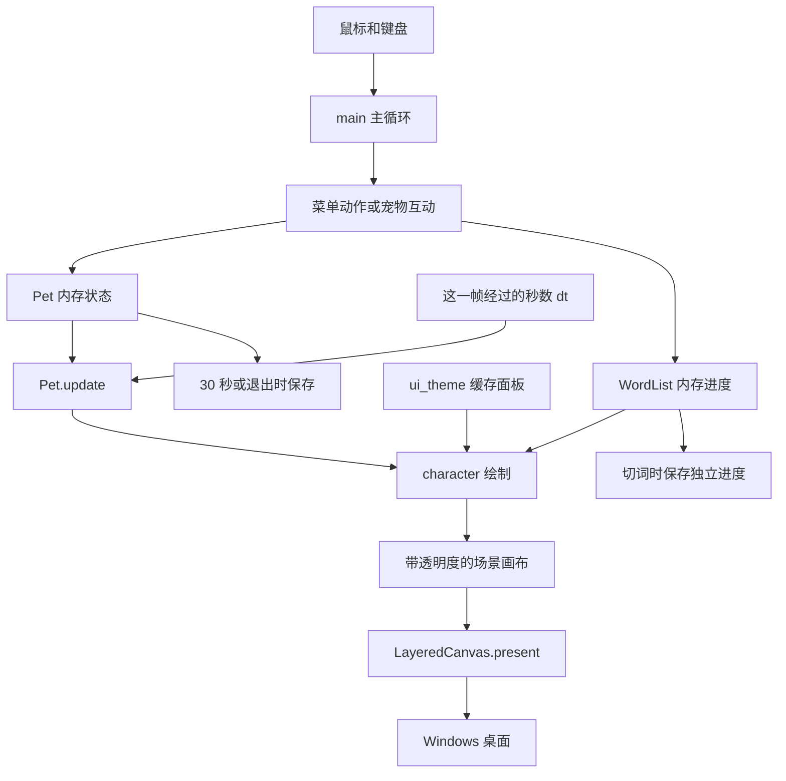
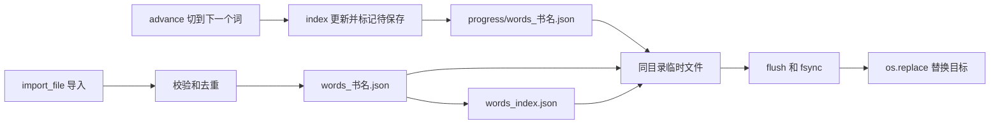
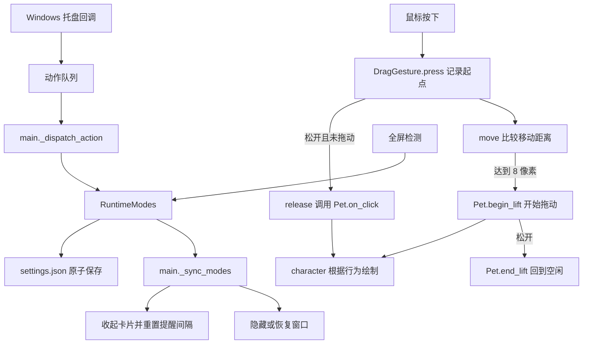
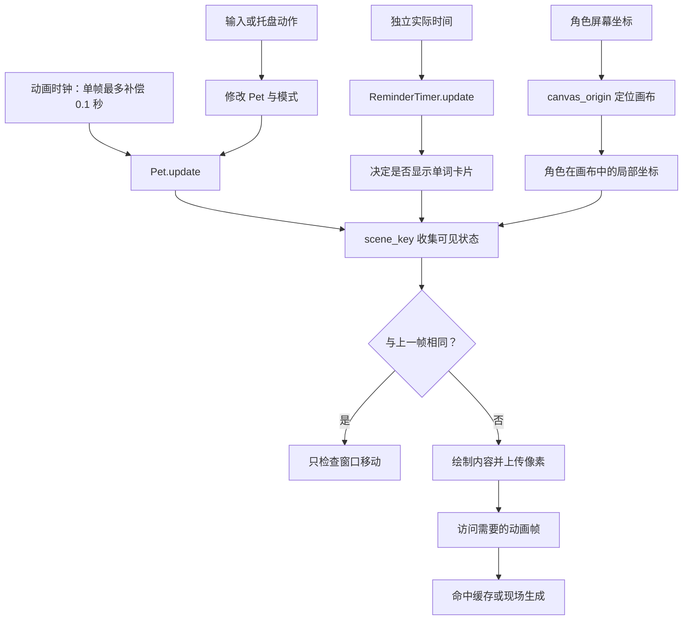
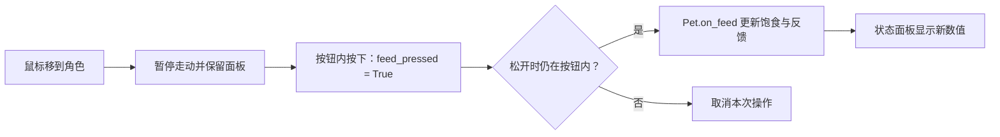
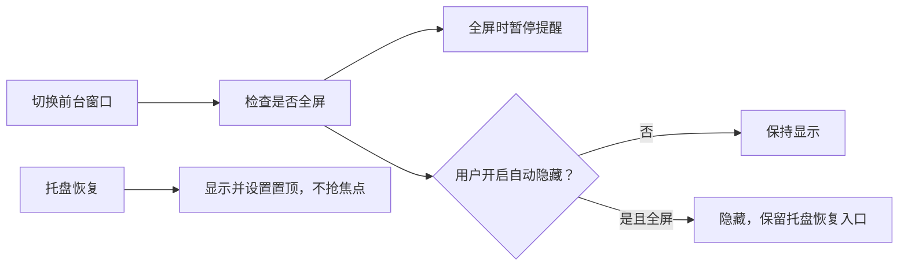

# 桌宠代码导读

先从 `main.py → Pet.update() → character.draw_pet()` 阅读，再看词库和窗口。主线是：
输入改变对象，对象按时间更新，绘制函数读取对象，窗口把画面显示到桌面。

## 先理解五个语法

```python
class Pet:
    def on_feed(self):
        self.hunger = min(100, self.hunger + 15)
```

- `class` 定义一类对象；`Pet()` 创建一只宠物。
- `def` 定义函数；调用函数时才执行函数体。缩进决定哪些语句属于这个函数。
- `self` 表示正在处理的那只宠物；`self.hunger` 是它自己的饱食度。
- `min(100, ...)` 限制最大值；`return` 返回结果，调用者可以判断成功或失败。
- `if` 根据条件执行；`for` 遍历；主循环中的 `while running` 不断更新桌宠。

```python
@property
def index(self):
    return self.books[self.active_book]['index']
```

`@property` 让函数像属性一样读取，写 `word_list.index` 就会运行它。
`@index.setter` 负责赋值时的校验和待保存标记。
字典的 `['index']` 根据键查找值；`.get('index', 0)` 则在键不存在时返回默认值。
集合用于记录哪些书需要保存，不会重复添加同一个书名。

`@lru_cache(maxsize=32)` 缓存最近 32 个输入对应的结果：同样的单词、释义和进度
再次请求布局时直接复用。因为字典不可作为缓存键，这里把字典拆成几个字符串传入。

`try / except / finally` 分别表示尝试执行、处理失败、始终执行清理。
`with open(...)` 会自动关闭文件；即使写入失败也不会忘记关闭。

## 数据在每一帧怎么流动



移动距离等于 `速度 × dt`。现有状态参数仍保留原来按 60 帧调好的数值，
通过 `frame_scale = dt × 60` 换算，避免重调宠物性格。GIF 帧选择直接使用累计秒数，
不依赖绘制次数。对话框关闭或系统卡顿后，单次补偿最多 0.1 秒，避免突然跳跃。

**为什么绘制函数不推进动画？** 同一状态可能先做点击检测，再绘制，甚至重复绘制。
如果绘制会改变状态，调用次数就会影响播放速度。更新负责变化，绘制负责读取。

## 存档与进度怎么流动



先完整写好临时文件再替换，写入中途失败时旧文件仍在。原子替换避免半截 JSON，
但并不承诺能抵抗所有硬件故障。写入失败不会清掉待保存标记，之后可重试。
没有独立进度文件时，仍读取旧词库中的 `index`，兼容现有资料。

**为什么分开存？** 词库内容通常不变，学习位置频繁变化。把两者放在一起，会让
一个数字的变化触发整本词库写入。本机测试约 1 MB 的词库写入中位耗时为 51.7 ms，
独立进度约 19 字节、1.8 ms；这些数字会随磁盘和运行环境变化。

## 各函数负责什么

### 启动和配置

| 函数 | 职责 |
|---|---|
| `main.main` | 单实例检查、创建窗口和对象、输入分发、更新、绘制、定期保存、退出清理 |
| `_install_crash_logger` / 内部 `_hook` | 建立滚动日志；把未捕获异常写入日志 |
| `config.get_resource_path` | 找到只读 GIF 和内置词库，兼容 PyInstaller 解包目录 |
| `get_data_path` | 选择源码目录、用户数据目录或便携目录；允许测试覆盖路径 |
| `prepare_data_directory` | 复制旧 EXE 旁的数据，只补缺失文件，迁移成功后写标记 |

`build.py` 在顶层整理 GIF 和词库文件，调用 PyInstaller；不把运行时的词库索引打入新程序。
`config.py` 在窗口创建前启用 DPI 感知，使输入坐标和窗口像素使用一致的坐标系。

### Pet：宠物模型

| 函数 | 职责 |
|---|---|
| `__init__` | 创建默认状态、计时器和边界，再恢复存档 |
| `update` | 按 dt 更新状态、行为、动画时间、特效和面板计时 |
| `show_panel` | 延长状态面板显示时间 |
| `_decay_states` | 降低饱食和心情，按行为恢复或消耗精力 |
| `_evaluate_behavior` | 定期评估行为；一次性互动动画播放时不切换 |
| `_choose_behavior` | 按精力、饱食、心情优先级决定睡觉、难过、休息或走动 |
| `_execute_behavior` | 执行走动，或结束开心、惊讶的短时行为 |
| `_clamp_position` | 找所在或最近显示器，限制角色位置，越过外侧横向边界时转向 |
| `_finish_animation` | 回到空闲并重置动画时间 |
| `_update_z_effect` | 按秒计算睡眠标记状态，供表现层使用 |
| `_update_feedback` | 按真实时间移动粒子、减寿命、计算透明度并删除过期项 |
| `add_feedback` / `add_particles` | 创建浮动文字或粒子数据 |
| `on_click` | 提升心情并触发开心行为 |
| `on_feed` | 增加饱食和少量心情，产生喂食反馈 |
| `on_pet` | 增加心情，产生抚摸反馈 |
| `on_right_click` | 触发惊讶行为 |
| `hit_test` | 用宠物中心和碰撞半径判断鼠标是否在宠物上 |
| `get_anim_name` | 把当前行为转换为动画名称；缺失动画由绘制层回退到 idle |
| `status_string` | 生成调试用状态文本 |
| `save` / `_load` | 原子保存或校验恢复状态；损坏文件先备份 |

### WordList：词库和学习进度

| 函数 | 职责 |
|---|---|
| `_valid_name` / `_book_path` / `_progress_path` | 验证书名并构建路径，禁止目录穿越和索引名称冲突 |
| `_normalize_words` | 校验字段类型、去掉空白、删除完全重复的词条 |
| `__init__` | 建立内存词库、待保存集合和损坏保护标记，再加载数据 |
| `words` / `index` 属性及 setter | 读取当前词库或进度；写入时校验并标记变化 |
| `_safe_index` | 把索引修正到有效范围；空词库返回 0 |
| `_error` | 保存错误消息并写日志，返回失败 |
| `_load_or_migrate` | 读取索引、迁移旧词库、扫描恢复或创建默认本 |
| `_copy_bundled_books` | 首次运行复制内置词库，不覆盖已有文件 |
| `_load_book` | 加载词库并叠加独立进度；损坏词库备份并禁止自动覆盖 |
| `_save_one_book` | 原子写入词库内容，成功后清除该内容的待保存标记 |
| `_save_progress` | 原子写入小进度文件，失败保留待保存标记 |
| `_save_active_book` | 保存当前本有变化的内容和进度，保留原有调用接口 |
| `_write_index` | 保存当前书名和目录 |
| `save` | 重试所有变化的数据；无变化的数据不写盘 |
| `has_words` / `get_current` | 判断是否有词并取当前位置的词条 |
| `advance` | 循环前进一词，只写进度，返回写入是否成功 |
| `get_active_book_name` | 返回当前书名 |
| `list_books` / `_scan_books` | 合并内存与磁盘词库目录，排除索引和备份文件 |
| `switch_book` | 保存当前变化，按需加载新书并保存当前书名 |
| `delete_book` | 删除词库和对应进度，当前本被删除时选择另一书；至少保留一本 |
| `import_file` | 读取、解析、生成不冲突的书名、保存并切换；写失败前不切换 |
| `_parse_json` | 解析词条列表、单词对象或包含 words 的对象 |
| `_parse_csv` | 按 CSV 引号规则解析，支持表头、逗号和多行释义 |
| `_parse_text` | 解析竖线、制表符或逗号分隔的普通文本 |

### character 和 ui_theme：表现层

| 函数 | 职责 |
|---|---|
| `_font` | 缓存字体对象 |
| `load_gifs` | 读取原始 GIF 帧与时长；反向帧注册为按需生成序列 |
| `animation_frame_index` | 从累计秒数和各帧结束时间选择动画帧 |
| `draw_pet` / `_draw_sprite` | 选择行为动画或 idle 回退，按方向显示精灵 |
| `draw_feedback` | 把粒子和浮动文字数据绘制出来 |
| `draw_kb_hint` | 提示点击宠物启用键盘操作 |
| `draw_status` | 悬停或交互后绘制状态面板 |
| `_wrap_text` | 按像素宽度换行释义，最多三行 |
| `_word_bubble_layout` / `_cached_word_bubble_layout` | 统一计算卡片几何信息并缓存文字，使绘制和点击检测一致 |
| `get_word_bubble_rect` | 返回卡片实际点击区域 |
| `draw_word_bubble` | 绘制词条、释义和当前位置 |
| `gradient_surface` / `rounded_mask` | 缓存渐变和圆角蒙版 |
| `_rounded_gradient` / `gradient_rounded` | 缓存完成裁切的渐变面板并绘制 |
| `_translucent_panel` / `translucent_rounded` | 缓存并绘制半透明圆角矩形 |

缓存内容由表现层读取，不能修改缓存中的原始画面；裁切前使用 `.copy()`。
缓存有数量上限，避免学完整个词库后内存持续增长。

### menus：交互和对话框

| 函数 | 职责 |
|---|---|
| `ContextMenu.__init__` | 创建菜单项、布局参数和选中状态 |
| `_visible_count` / `_menu_w` / `_menu_h` / `_items_top` | 菜单几何属性 |
| `show` / `hide` | 显示、放置或隐藏菜单 |
| `contains` | 判断是否在菜单区域内，不改变状态 |
| `move_grid` | 按两列视觉布局移动键盘选中项 |
| `activate_selected` | 关闭菜单并返回当前动作名称 |
| `_item_rect` / `_index_at` | 计算菜单项矩形，并找到坐标对应的项 |
| `hit_test` | 点击时关闭菜单并返回动作；外部点击关闭菜单 |
| `update_hover` / `draw` | 更新悬停项或绘制菜单 |
| `_do_import_words` | 文件对话框导入，并显示结果 |
| `_do_switch_book` | 选择或删除词库的对话框 |
| 内部 `refresh_list` / `on_ok` / `on_delete` / `on_double_click` | 刷新列表、确认选择、删除选择、双击确认 |
| `_do_delete_book` | 确认删除当前词库，并更新卡片状态 |
| `_do_set_interval` | 校验并保存提醒间隔，重置计时器 |
| `_handle_menu_action` | 将动作名称映射到操作；退出动作返回 False |

### Windows 和共用存储

| 函数 | 职责 |
|---|---|
| `desktop.work_areas` / 内部 `collect` | 每秒最多枚举一次显示器，收集扣除任务栏后的区域 |
| `nearest_work_area` / 内部 `distance` | 找包含宠物中心或距离最近的工作区域 |
| `window._get_hwnd` | 取得 pygame 对应的 Windows 窗口句柄 |
| `_window_focused` | 判断键盘焦点是否在宠物窗口 |
| `_set_window_layered` | 启用透明、置顶和工具窗口样式 |
| `_set_clickthrough` | 切换鼠标是否穿透窗口 |
| `_get_cursor_screen_pos` / `_is_lbutton_pressed` | 查询全局鼠标坐标或左键状态 |
| `_LayeredCanvas.__init__` | 创建可写位图和绘图上下文，保存原来选中的位图 |
| `present` | 内容变化时对比并上传像素；内容未变化时直接检查位置 |
| `close` | 恢复原位图，再释放位图和绘图上下文，可重复调用 |
| `storage.write_json_atomic` | 同目录临时写入、刷盘、原子替换和失败清理 |
| `backup_corrupt` | 复制带时间戳的损坏文件备份，不删除原件 |
| `finite_number` | 拒绝非数值、布尔值和无穷值，应用上下限 |

`ctypes.Structure` 声明 Windows 需要的数据结构；`argtypes` / `restype` 声明参数与返回类型。
64 位句柄不能当作普通 32 位整数处理，否则指针可能被截断。

## 如何继续做决策

1. **为什么不用线程保存？** 当前切词只写很小的文件，先减少写入量，更容易保证顺序一致。
   如果以后在低速磁盘上仍有可测量卡顿，再考虑单一保存队列，避免多个线程同时改进度。
2. **为什么保留 60 帧？** 拖动和粒子反馈对响应更敏感；空闲时 30 帧减少工作量。
   可以先观察实际体验，再测 CPU，不能只凭帧数推算节能比例。
3. **为什么损坏词库不能自动写空本？** 空本会覆盖唯一的学习资料。保留原件和备份，
   让用户修复或重新导入更容易恢复。
4. **为什么源码和 EXE 的存档目录不同？** 开发时资料留在项目方便检查；正式程序所在目录
   可能无写权限，用户数据目录适合长期保存。便携模式保留随程序移动数据的选择。
5. **为什么先保持学习交互？** 这轮重点是稳定性和流畅度。隐藏释义、自测和间隔复习会改变
   使用习惯，应另行决定提醒式浏览还是主动测验。

## 验证范围

回归测试覆盖真实 Windows 位图上传和资源计数、正常退出与注入异常后的清理、定期保存、
写盘失败、备份失败、旧数据迁移、同名导入、CSV、缓存上限，以及不同帧率的一致性。
多显示器负坐标和断开使用模拟区域测试；实际多显示器、混合缩放和屏幕热插拔仍需硬件体验确认。
基准程序使用临时目录，不写用户现有词库。

## 第一批改进：手势、模式与托盘



### 函数职责

| 函数或属性 | 做什么 |
|---|---|
| `DragGesture.__init__` | 创建阈值、是否等待手势和按下起点 |
| `press` | 记录屏幕起点和鼠标相对宠物中心的偏移，不立即奖励点击 |
| `move` | 比较距离平方；达到阈值后提起宠物，再移动并限制边界 |
| `release` | 补处理最后一次移动；只有没拖动且松开在宠物上才点击 |
| `cancel` | 清除等待状态，结束提起，不产生点击奖励 |
| `RuntimeModes.__init__` / `_load` | 创建默认模式并校验恢复设置，损坏时备份 |
| `visible` | 合并手动隐藏、全屏隐藏和恢复入口是否可用 |
| `learning_paused` | 合并隐藏、安静、限时暂停和今日暂停 |
| `refresh` | 更新真实时间及全屏状态；`None` 表示保留原判断 |
| `show` | 手动恢复，允许在当前全屏期间显示 |
| `apply_action` | 处理模式动作，修改偏好后保存 |
| `snapshot` | 生成普通字典供托盘、菜单和主循环读取 |
| `_settings` / `save` | 只保存持久偏好；无变化不写盘，失败后可重试 |
| `main._dispatch_action` | 把动作交给模式或原菜单；无恢复入口时拒绝隐藏 |
| `main._sync_modes` | 应用显示变化，取消拖动，重置卡片和提醒计时 |
| `TrayIcon.__init__` / `_create_pet_icon` | 创建原生消息窗口、角色图标及全局快捷键 |
| `_add_icon` | 添加图标并启用支持键盘操作的托盘协议 |
| `available` | 判断图标或全局快捷键是否能提供恢复入口 |
| `_wnd_proc` | 接收系统事件，排队动作；任务栏重建时恢复图标 |
| `menu_items` / `_popup_menu` | 根据模式生成菜单，选择后排队动作，再释放菜单 |
| `set_state` | 更新菜单状态和托盘提示文字 |
| `poll` | 主循环处理原生消息、重试图标恢复，并取走动作队列 |
| `close` | 删除图标、注销快捷键、销毁窗口与图标，可重复调用 |
| `Pet.begin_lift` / `end_lift` | 开始或结束提起行为，不增加心情 |
| `settle` / `recenter` | 停止走动，或移到鼠标所在显示器中央 |
| `character._build_interaction_animations` | 注册按需生成的互动帧；自定义同名 GIF 优先 |
| `_draw_hand` / `_draw_heart` | 绘制动作中的小手和心形反馈 |
| `ContextMenu.set_runtime_state` | 同步隐藏和安静模式的菜单文字 |
| `desktop.covers_monitor` / `foreground_is_fullscreen` | 对比窗口和显示器完整区域，排除任务栏、桌面和自己的窗口 |
| `window.set_window_visible` / `LayeredCanvas.invalidate` | 不抢焦点地恢复窗口，并让下一帧重新上传画面 |

### 基础语法与为什么这样做

`dx * dx + dy * dy >= threshold ** 2` 中，`** 2` 表示平方。
比较距离平方和阈值平方即可判断是否拖动，不需要先计算平方根。
`self.origin = x, y` 创建含两个坐标的元组；`x, y = self.origin` 则把它拆开。

`deque()` 是先进先出的队列。Windows 回调只把动作 `append` 进去，主循环通过
`poll()` 取走，避免不同入口同时改变宠物状态。`@property` 让 `modes.visible`
每次读取时重新计算，因此全屏、暂停和手动恢复不需要维护多份互相矛盾的状态。

**为什么松开才算点击？** 按下时还不知道用户是想点击还是拖走。
提前奖励点击会让一次拖动同时触发开心动作；等待到松开才能确认意图。

**为什么恢复后重新等待？** 用户刚结束暂停或全屏时，立即弹卡片容易打断手头操作。
重置计时不推进词库，因此不会漏掉暂停前的单词。

**为什么恢复能力不保存？** 托盘失效是当前环境的故障，全屏隐藏是用户的偏好。
当前无法恢复时临时保持可见，重启后继续使用原来的偏好。

可以接着问：安静模式下是否应该暂停饱食变化？拖动阈值是保持固定像素还是提供设置？
目前选择继续更新状态、固定 8 像素，保持操作简单；如果实际使用中出现困扰，再依据反馈调整。

第一批新增测试覆盖暂停到期与跨日、重启恢复、保存重试、手势误触、模式同步、
真实角色动画差异，以及主循环中托盘动作的隐藏、恢复和退出数据流。
原生托盘测试在真实 Windows 桌面检查消息、快捷键回调、任务栏重建恢复及资源计数；
用删除自己的图标再发送重建消息模拟恢复，不关闭用户的资源管理器。

## 本轮优化：按需生成、按需绘制、独立计时



| 函数或属性 | 做什么 |
|---|---|
| `_LazyFrames.__init__` | 保存帧数、缓存标识和生成函数，此时不生成画面 |
| `__len__` / `__getitem__` | 提供长度、索引、负索引和切片；访问时复用或生成一帧 |
| `_interaction_frame` | 从现有角色生成指定动作的一帧，不改变角色状态 |
| `animation_memory_bytes` | 统计已经存在的像素缓存，不触发懒加载 |
| `scene_key` | 收集动画帧、面板、反馈、卡片及菜单等可见状态，供主循环比较 |
| `_position_bubble` | 根据角色局部坐标摆放卡片，优先上方，空间不足时放下方 |
| `movement_bounds` | 限制角色在显示区域中移动；相邻屏幕的共享边缘允许通过 |
| `canvas_origin` | 计算透明画布的屏幕起点，边缘处移动角色的局部位置 |
| `ContextMenu.reposition` | 把菜单限制在当前画布内，保留已选项 |
| `ReminderTimer.__init__` / `update` | 用单调时钟计时；暂停、菜单或长阻塞返回后重新等待 |
| `RuntimeModes.status_text` | 根据当前模式生成暂停原因或剩余分钟 |
| `LayeredCanvas.move` | 只更新窗口位置，复用已经上传的像素 |

`Sequence` 让对象支持列表式访问：`frames[0]` 取第一帧，`frames[-1]` 取最后一帧，
`frames[:2]` 取前两帧。`lambda` 是简短的函数表达式，这里保存“将来怎样生成帧”，
而不是立即生成。`OrderedDict` 保留顺序：访问过的帧移到末尾，空间不足时淘汰最久未用的帧。
这些派生画面共享 8 MiB 上限，淘汰后可以重新生成，因此不会丢失动画内容。

`key == render_key` 比较两个元组的内容。这里只放会影响可见像素的信息：
隐藏面板的饱食变化无需重画；面板显示时数字或进度条变化就要重画。
角色世界坐标变化但局部坐标不变时，只需要移动窗口；到屏幕边缘局部坐标变化时仍会重画。

**为什么不用动画的 dt 提醒？** 动画为了防止跳跃，把一次补偿限制在 0.1 秒；
提醒若也使用它，短卡顿就会让间隔变长。独立时钟让两个目标各自成立。
单调时钟用于计算经过多久，暂停截止时间仍用实际日期时间，才能跨重启恢复。

**为什么缓存有上限？** 本机现有素材的动画像素缓存由约 152 MiB 降到峰值约 50 MiB；
第一次生成互动与反向帧约 0.6–0.9 ms。代价是缓存淘汰后需要再次计算。
这是像素缓存的测量，不等于整个程序的内存，也不能据此推算 CPU 降幅。

可以继续问：如果加入更大的角色素材，应该提高缓存上限还是缩小帧尺寸？如果卡片总在
相同位置出现，应该固定卡片位置还是继续跟随角色？当前保留轻量缓存和跟随布局，
后续依据实际卡顿及遮挡体验再决定。

## 快捷喂食

悬停角色后直接点击面板底部的“喂食”按钮。`_status_rect` 统一计算面板位置，
`get_feed_button_rect` 从它得到按钮区域，绘制、鼠标穿透和点击判断使用同一矩形。
面板隐藏或单词卡片显示时返回 `None`，表示没有可点的喂食按钮。



`bool(rect and rect.collidepoint(...))` 会先检查矩形是否存在，再判断坐标是否落在里面。
`feed_pressed` 只记录这次按下从按钮开始，不修改饱食；松开确认后才调用原有 `on_feed`。
按钮不进入拖动手势，也不请求键盘焦点。`scene_key` 包含按钮悬停状态，颜色变化会触发重画。

**为什么悬停时暂停走动？** 入口随角色移动，点击一个移动的目标很费力。
冻结走动并保留 1.5 秒的面板，让鼠标能从角色移到按钮；状态变化与互动动画继续更新。
这次保留原喂食数值与快捷键，仅缩短操作路径。

## 防止切换窗口后消失

全屏自动隐藏现在默认关闭；全屏期间只暂停学习提醒。当前用户正式版设置已关闭自动隐藏。
以前明确保存的设置仍会读取，其他用户可以在托盘选择是否开启。
Esc 现在取消当前交互或收起卡片，不退出程序；退出仍通过右键菜单或托盘。

`window.ensure_topmost` 使用 `SetWindowPos` 明确设置窗口层级；启动和恢复显示时调用，
参数同时要求不移动、不缩放、不激活。改变窗口样式与实际设置窗口层级是两步操作，
相关接口见 [Windows 文档](https://learn.microsoft.com/en-us/windows/win32/api/winuser/nf-winuser-setwindowlongw)。


